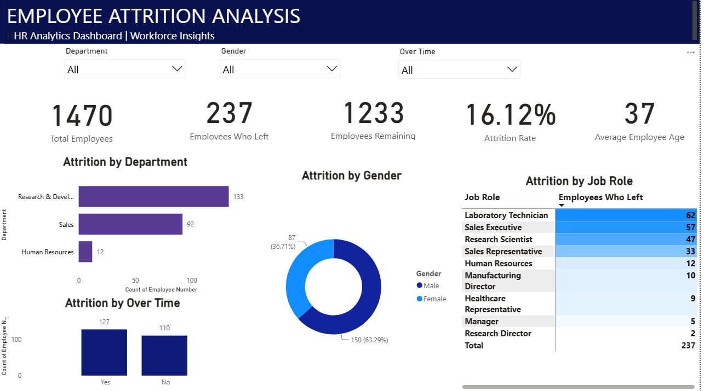
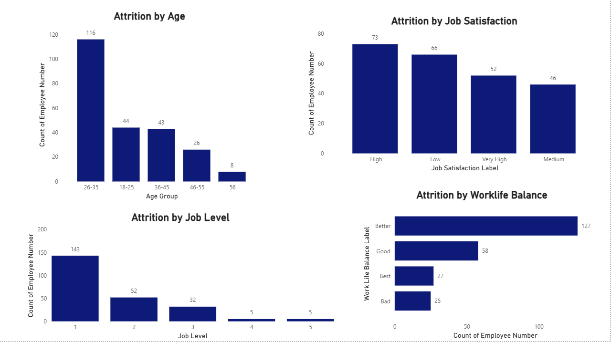

Here is the complete, single, unified README.md documentation for your repository:
# 📊 Employee Attrition Analysis Dashboard | Power BI

> **Turning HR & Employee Data into Actionable Workforce Insights**

---

## 📌 Project Overview

Employee attrition is an important workforce challenge that can affect organizational stability, productivity, and employee retention.

This project uses **Microsoft Power BI** to explore employee attrition patterns and workforce characteristics. The interactive, multi-page dashboard presents key performance indicators (KPIs) and visualizations that help users investigate employee departures across different job roles, job levels, demographic groups, and job-related factors.

---

## 🎯 Project Objectives

* Analyze employee attrition across departments and job roles.
* Explore attrition patterns across job levels and demographic groups.
* Investigate job satisfaction and work-life balance in relation to attrition.
* Examine workforce patterns across different age groups.
* Develop an interactive, multi-page dashboard using Power BI.
* Communicate workforce trends through meaningful visualizations.

---

## 🖼️ Dashboard Overview & Preview

### 📄 Page 1 — Employee Attrition Overview


### 📄 Page 2 — Workforce Attrition Insights


---

## 🛠️ Tools & Technologies Used

* **Microsoft Power BI Desktop:** Dashboard architecture and interactive visual design.
* **Power Query:** Data cleaning, type transformation, and conditional column creation.
* **DAX (Data Analysis Expressions):** Measures for headcount, total departures, attrition rates, and dynamic KPIs.
* **Data Visualization:** Synchronized slicers, KPI cards, bar charts, column charts, doughnut charts, and matrix visuals.

---

## 📐 Key DAX Measures Developed

```dax
// 1. Total Employees
Total Employees = COUNTROWS('EmployeeData')

// 2. Employees Left (Attrition Count)
Employees Left = CALCULATE(COUNTROWS('EmployeeData'), 'EmployeeData'[Attrition] = "Yes")

// 3. Employees Remaining
Employees Remaining = CALCULATE(COUNTROWS('EmployeeData'), 'EmployeeData'[Attrition] = "No")

// 4. Attrition Rate (%)
Attrition Rate = 
DIVIDE(
    [Employees Left], 
    [Total Employees], 
    0
)

// 5. Average Employee Age
Avg Employee Age = AVERAGE('EmployeeData'[Age])

💡 Key Business Insights & Takeaways
 * Overtime Impact: Employees working overtime exhibit significantly higher attrition rates compared to non-overtime staff.
 * Role Vulnerability: Entry-level positions and specific departments (e.g., Sales Representatives, Lab Technicians) account for a high volume of departures.
 * Satisfaction Thresholds: A strong negative correlation exists between low Job Satisfaction / Work-Life Balance ratings (Scores 1 & 2) and retention rates.
 * Volume vs. Rate Perspective: High-volume departments show large departure counts, but smaller specialized teams often hold higher overall percentages of attrition, demonstrating the value of dual-metric analysis.
🔍 Analytical Perspective
Employee departure counts and attrition rates provide different perspectives. Counts show where the largest numbers of employees left, while attrition rates compare departures with the total employee population within each group.
Considering both measures can help users make more meaningful comparisons between workforce groups of different sizes.
> Note: The dashboard supports exploration of these patterns; it does not establish that any particular factor causes employees to leave.
> 
🧠 Skills Demonstrated
 * Data cleaning and transformation (Power Query)
 * HR analytics and workforce analysis
 * DAX measures and KPI development
 * Data visualization and dashboard design
 * Interactive reporting and filter synchronization
 * Data storytelling and analytical perspective
 * Business-oriented analytical thinking
📁 Repository File Structure
| File | Description |
|---|---|
| Employee_Attrition_Analysis.pbix | Core Power BI Desktop report file containing model & dashboards |
| dashboard_page1.png | High-resolution screenshot of Dashboard Page 1 |
| dashboard_page2.png | High-resolution screenshot of Dashboard Page 2 |
| README.md | Project documentation and analytical summary |
🚀 How to View & Run the Project
 * Clone or Download this repository to your local machine.
 * Ensure you have Microsoft Power BI Desktop installed.
 * Open Employee_Attrition_Analysis.pbix.
 * Interact with the cross-filtering, dynamic slicers, and synchronized page navigation.
🏁 Conclusion
This project demonstrates how Microsoft Power BI can transform employee data into an interactive HR analytics dashboard. By exploring workforce characteristics and employee departures through multiple visual perspectives, the report provides a foundation for investigating attrition patterns and supporting data-informed HR discussions.
Developing this project strengthened my practical skills in data preparation, KPI development, analytical reporting, and interactive dashboard design as part of my Data Analyst portfolio.
Tools used: Microsoft Power BI Desktop | Power Query | DAX
Created as a data analytics portfolio project.
